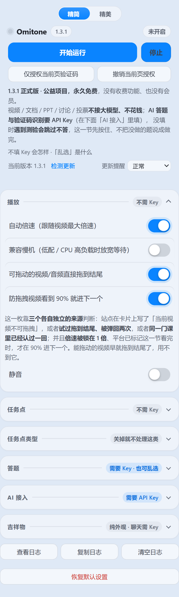
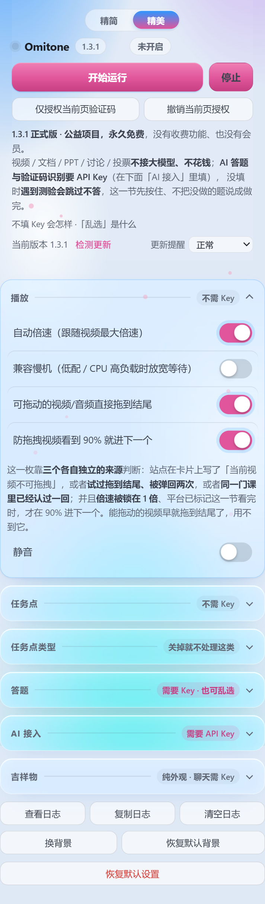

<div align="center">

# Omitone

**学习通（超星 / Chaoxing）网页版的学习辅助浏览器扩展**


**免费 · 公益 · 本地运行 · AI 由你自己接入**

### [**⬇ 点我下载插件（omitone.zip）**](https://github.com/TYT0807/Omitone/releases/latest/download/omitone.zip)

[**📖 在线看图解说明书**](https://tyt0807.github.io/Omitone/docs/manual.html) &nbsp;·&nbsp; [**下载 PDF 版**](https://github.com/TYT0807/Omitone/releases/latest/download/Omitone-manual.pdf)

<sub>👆 上面两条是 **1.3.1 正式版**的入口 —— 绝大多数人装这个就对了，本页往下所有说明也都按这一版写。</sub>

<sub>🧪 **想帮下一版试错？** [预览版 omitone-preview.zip（1.3.2 实验版）](https://github.com/TYT0807/Omitone/releases/download/preview/omitone-preview.zip) · [预览版说明书 PDF](https://github.com/TYT0807/Omitone/releases/download/preview/Omitone-manual-preview.pdf) —— 它可能把你正在刷的课弄坏，只给愿意反馈问题的同学；只想安静刷课就留在上面的正式版。</sub>

<details>
<summary>🧪 <b>更新记录</b>：1.3.2 预览版新增（点开）</summary>

#### 1.3.2 预览版新增（2026-11-25 起；2026-11-26 刷新）

- **2026-11-25** · 1.3.1 的答题与视频修复已经进正式版；预览版升到 1.3.2，从队列继续修下一批。
- **2026-11-25** · 修复了刷新后模型限流退避被清零、导致重复烧请求的问题。
- **2026-11-25** · 桥就绪日志现在报出是哪一份文档，反馈时能分清同址重载。
- **2026-11-25** · 更新提示现在会分清「稳定版」「预览版」和本地开发构建，不再把预览版说成“可能是实验版”。
- **2026-11-25** · 阅读任务点（预览卡里那种「点击去阅读」）现在会自动完成，不再空转。
- **2026-11-25** · 暗色模式下下拉不再发白，模型候选列表可以滚动。
- **2026-11-25** · 静音开关已移除：要静音直接点播放器或标签页的静音按钮。
- **2026-11-26** · 少用的三个设置（讨论回复、乱选检查秒数、看图次数上限）收进「高级」，设置页更清爽。
- **2026-11-26** · 「通过标准：60 分」这类卷面说明不再被当成已通过，不会因此跳过未交或低分卷。
- **2026-11-26** · 「更新提醒」移入「高级」，顶部更新条更精简。

1.3.1 的完整改动清单见 [1.3.1 Release 页](https://github.com/TYT0807/Omitone/releases/tag/v1.3.1)。

</details>

> 1.3.1 已进正式版；只有 1.3.2 起的新增在预览包里，正式版下载不受影响。

<sub>**不懂 GitHub 也没关系** —— 第一个链接点下去，浏览器会自己开始下载：
不用注册、不用登录、不用点绿色的 Code 按钮、不用装 Git。<br>
说明书的在线版和 PDF 版是同一份内容，每个要动手的地方都配了四问 ——
**看到什么 → 点哪里 → 怎样才算对 → 不对怎么办**。</sub>

> ⚠️ **它只能装在电脑浏览器（Edge / Chrome）里。** 学习通的**电脑客户端、手机 APP、平板 APP
> 装不了这个插件，它在那里面也不会工作** —— 那些软件里没有"扩展"这个东西。
> 判断自己在不在网页版：屏幕最上面有**一条能输网址的地址栏**、里面是 `…chaoxing.com/…`。
> 网页版入口：[i.chaoxing.com/base](https://i.chaoxing.com/base)
> （没登录会自己跳到[登录页](https://passport2.chaoxing.com/login)）。

</div>

## 先说每个人都该知道的三件事

- **这个插件绝对公益、永久免费。** 没有收费功能、没有会员、没有代理、不放广告、不引流，也没有任何「充值后才能用」的路径 —— 项目里压根不存在收费这一条链路。
- **刷课不是「不用 API Key」。** 视频、文档、轮盘 PPT、任务点翻页、讨论与投票，这几族确实不接大模型、一分钱不花；但课里的**测验 / 作业（AI 答题）和验证码识别要 Key**。不填 Key 也能刷，只是**遇到测验会跳过不答**（压着题的那一节先按住、不把没做的题说成做完，超过 3 分钟才跳过并写明「这些题没做过」），其余照常。
- **只有两样需要 Key：AI 答题、验证码识别。** 默认按 **DeepSeek** 写（官网
  [platform.deepseek.com](https://platform.deepseek.com/)，弹窗「AI 接入」里有一键直达的链接）。你也可以一家都不接：答题改用弹窗里的**乱选**（不接 AI、随机作答），验证码自己手动输一次。

> ⚠️ **用途限定：仅供学习与技术交流。** 拿它去考试、或代刷计入考核的作业，那就是作弊，后果自负。完整的边界与代价写在下面「先花一分钟读完这四件事」和「已知缺陷与重要限制」里。

<div align="center">

<p align="center">
  <a href="https://github.com/TYT0807/Omitone/blob/main/docs/images/popup.png"></a>
  <a href="https://github.com/TYT0807/Omitone/blob/main/docs/images/popup-fancy.png"></a>
</p>

<p align="center">
  <sub><strong>左：默认的「精简」档</strong> —— 顶部是版本号与运行状态，下面按「播放 / 任务点 / 答题 …」分组，用不到的直接折叠，它还会记住你折了哪些。<br>
  <strong>右：「精美」档</strong> —— 多一个小角色：摸摸头、换装换表情，还有<strong>好感度养成</strong>（她身旁的「初识」就是等级铭牌）。刷课时她也会跟到学习页右下角陪你，纯装饰，不影响刷课。<br>
  两张都是真实截图，点图可看原图。</sub>
</p>

</div>

<details>
<summary><strong>1.3.1 稳定版（2026-11-25）动了什么 · 怎么升级</strong> —— 明细不堆在门面，点开看</summary>

**1.3.1 稳定版**：把答题与视频两条主线整条修了一遍 —— 选项顺序被平台打乱时不再点错、多选题按字母序交卷、交卷长时间不判分会有界放手、验证码窗空着绝不点确定；视频开头黑屏会自动点「开始」、倍速问不到就按原速播完、坏包恢复三次仍无进展就隔离；一门刷完能自己换下一门。弹窗里还有**本地自愈「医生」**：出问题时先读本机日志，给你一句能照着做的建议。完整说明见 [Releases 页面](https://github.com/TYT0807/Omitone/releases/latest)。

**更早的 1.3.0（2026-11-12）明细**：[1.3.0 Release 页](https://github.com/TYT0807/Omitone/releases/tag/v1.3.0) 有完整一页；这里只保留 1.3.1 的升级方式。

**怎么升级（三步，缺一不可）**

1. 下载 [**omitone.zip**](https://github.com/TYT0807/Omitone/releases/latest/download/omitone.zip) 解压，**覆盖**原来那个文件夹；
2. 打开 `edge://extensions`，找到 Omitone，点**重新加载**；
3. **回到学习通那一页按 F5。** 只重载扩展不刷新页面，页面里跑的还是旧脚本，症状就是「改完没变化、日志也不动」。

设置和密钥都沿用，不用卸载重装。

**更早的版本改了什么？** 上一版（1.2.9）修掉了验证码填完却停在原页不往下走的问题，外观整块换成磨砂玻璃，小角色一口气加了 11 种动作、88 张立绘；再往前（1.2.8）修掉「明明还有任务点、插件却没做」那一整类。每一版的完整说明见
[Release 页](https://github.com/TYT0807/Omitone/releases/latest) 与 [CHANGELOG](CHANGELOG.md)。

</details>

---

<div align="center">

**📖 目录** &nbsp;·&nbsp; [三步装好](#三步装好不懂-github-也能做) &nbsp;·&nbsp;
[已知缺陷](#已知缺陷与重要限制) &nbsp;·&nbsp; [它能做什么](#它能做什么) &nbsp;·&nbsp;
[密钥安全](#密钥安全为什么说它偷不走) &nbsp;·&nbsp;
[🛠 开发者区](docs/DEVELOPER.md)

</div>

---

## 三步装好（不懂 GitHub 也能做）

> 这一段假设你**从没用过 GitHub、也没写过代码**。照着做就行，一共三步。

### 第 1 步 · 下载

点上面那个 [**点我下载插件（omitone.zip）**](https://github.com/TYT0807/Omitone/releases/latest/download/omitone.zip)。

浏览器会直接开始下载一个叫 `omitone.zip` 的文件（约 2.3 MB，大部分是 100 张立绘）。它通常会出现在你的「下载」文件夹里。

> 点下去如果只是打开了一个网页、没有开始下载，就在那个页面里再找一下
> `omitone.zip` 这一行，点一下它右边的下载图标。

### 第 2 步 · 解压

找到刚下载的 `omitone.zip` → **右键 → 选「解压」那一项**（Windows 自带这一功能，不用装任何软件）。

> 右键里那一项**各家字不一样**：Windows 自带的写作 **全部解压缩**（有些版本写作「提取全部」），装了 7-Zip / WinRAR / 360 压缩 / Bandizip 的多半写作 **解压到当前文件夹**、**解压到当前位置**、**一键解压**。**认结果不认字**：解开后第一屏直接摆着 `manifest.json` 就对了。只有「添加到压缩文件」那一族是反方向（那是打包），别点它。

> **Windows 11 的右键菜单是收起来的** —— 先点最下面的「显示更多选项」（或按 `Shift + F10`）才看得见上面那几项。

解压完会多出一个文件夹，打开它，里面应该能**直接看到** `manifest.json` 和 `page.js`。

> 那个文件夹**叫什么不重要** —— 名字跟着 zip 走：下过一次通常叫 `omitone`，
> 下过不止一次可能是 `omitone (1)`、`omitone-1.3.0`，甚至被解压软件丢进 `新建文件夹`。
> **认它只认一条：打开后第一屏就直接摆着 `manifest.json`。**

> ⚠️ **这一步必须做，而且最容易做错。**
> 浏览器要选的是**解压后的文件夹**，不是那个 `omitone.zip` 压缩包本身。
>
> 如果你直接双击 zip 打开、在里面选了东西 —— 一定会失败。请先把 zip **整个解开**，再去选解压出来的**文件夹**。

### 第 3 步 · 装进浏览器

以 **Edge** 为例（Chrome 完全一样，把 `edge://` 换成 `chrome://` 即可）：

1. 打开浏览器，地址栏输入 `edge://extensions` 然后回车
2. 打开页面上的「**开发人员模式**」开关（Edge 在**左下角**，Chrome 在**右上角**）
3. 点「**加载解压缩的扩展**」
4. 在弹出的选择框里：双击走进**第 2 步解压出来的那个文件夹**，
   走到列表里**直接看得见 `manifest.json`** 那一屏就**停手**，点右下角「选择文件夹」。
   > 这个窗口里**双击 = 走进那一层，不是选中**；按下「选择文件夹」时，选中的是**你此刻站着的那一层**。
   > 所以最常见的错是**一路双击点到底**（点进了 `libs` 或 `popup` 里再按），
   > 那一下浏览器会报「清单文件缺失」—— 点窗口上方的「向上 / ↑」退一层，回到那一屏再按就行。
5. 列表里出现 **Omitone** 就成功了 —— 浏览器工具栏上也会多出它的图标

到这里扩展就装好了。

**第一次用**：打开学习通课程页 → 点浏览器工具栏上的那个扩展图标 → 点「**开始运行**」。（这一步要手动点一次，之后它自己跑。）

**找不到图标？** 点地址栏右边的拼图菜单 → 找到 **Omitone** → 点它右边的「固定到工具栏」，图标就会一直显示；不然第一次用容易以为插件没反应。

**AI 答题需要额外填一次 API Key**（不填也能用，只是遇到测验会跳过不答），怎么申请、怎么填，见 [在线说明书](https://tyt0807.github.io/Omitone/docs/manual.html) 第 3 节。

**卡在哪一步了？** → [在线说明书](https://tyt0807.github.io/Omitone/docs/manual.html)
**第 0 节「五分钟装好」**就是为这个写的：四步走完，每步都告诉你「怎样才算对」。第 1、2 节有每一步的**界面示意图**（标出该点哪儿），第 7 节是常见问题排查（「装了没反应」、「扫不到题」、「日志不动」都在里面），第 7.1 节还把日志里那些**英文单词**逐条翻译了一遍。

> **给想改代码的人**：这一节是给使用者的。开发环境的搭建、目录结构、测试怎么跑，见下面 [§10 开发命令](docs/DEVELOPER.md#10-开发命令) 与 [HANDOVER.md](HANDOVER.md)。

---

## ⚠️ 先花一分钟读完这四件事

**1. 这是公益项目：完全免费，永远不会有收费版、会员群、付费解答。**

没有赞助链接，没有打赏二维码，不卖 Key，不引流到任何地方。如果有人拿着它向你收费 —— 那是骗子，与本仓库无关。

**2. AI 功能要你自己接 API Key，本工具不带任何 AI 能力。**

视频播放、文档、PPT、阅读、讨论、投票这些**不需要 Key**，装上就能用。只有「AI 答题」和「验证码识别」需要你自己填 API Key —— 去任意一家大模型厂商申请即可（多数有免费额度，几块钱能用很久）。**没填 Key 时，遇到测验会跳过不答**（不是"整门课照样刷完"），要连题一起做就得填。

**3. 你的密钥偷不走 —— 因为外面根本没有接收方。**

见 [密钥安全这一节](#密钥安全为什么说它偷不走) —— 里面给了你可以自己验证的命令，不需要相信我这边的任何一句话。

**4. ⚠️ 用途限定：仅供学习与技术交流。用于「作弊」的一切风险，由你自己承担。**

先把话说在前面，不含糊：

- **本工具的定位是「学习辅助」，不是「替你完成学业」。**
  它适合的是那种「看了三遍还是这几句话、纯粹在消耗时间」的部分 —— 把这段时间还给你，去做真正需要动脑的事。
- **如果你用它来完成本应独立完成、且计入考核的作业或考试，那就是作弊。**
  这是你的选择，**不是我的建议**。
- **由此产生的一切后果 —— 成绩作废、课程挂科、纪律处分、学籍影响 —— 全部由使用者本人承担，与本项目、与原始作者无关。**
- 请遵守你所在学校的规章制度与学习通的用户协议。不同学校、不同课程对自动化工具的容忍度差别很大，**你比我更清楚边界在哪**。

它不会代替你输入账号密码，也不会代替你发布任何内容（见 §13 边界）。

**另外，请顺手读完 [已知缺陷与重要限制](#已知缺陷与重要限制)**
—— 里面写清了「只有 DeepSeek 是真跑通过的」、「正确率没有保障，考试请别用」这类实情。把它读完，比读完剩下的部分都重要。

> 下一节是**已知缺陷清单**，比上面任何一句话都具体。里面写了「只有 DeepSeek 是验证过的」以及「默认最多尝试交卷 20 次」这类真相 ——
> **如果你打算用在考试或有次数限制的任务上，请务必先读完它。**

---

## 已知缺陷与重要限制

这一节不是免责套话，是逐条核对过代码的实情。请把它当作「能不能用」的判断依据。

长说明都折起来了：摊开看到的只有结论，点开才是机制与条款。

### 1. 只有 DeepSeek 是真正在真实答题中跑通过的

**DeepSeek = 在真实章节测验里完整验证过**（抠题 → 作答 → 回填 → 交卷 → 记分）。其他渠道的地址与模型名是照**厂商官方文档**填的快照，协议也适配过、集成测试覆盖了，但**没有在真实题库上跑过**，界面上都如实标着「未实测」。

预置清单（1.1.5 起）：

| 接入方式 | base_url | 模型名（快照） | 实测 |
| --- | --- | --- | --- |
| **DeepSeek** | `https://api.deepseek.com` | `deepseek-flash`（= V4.1 Flash，**含看图**） | ✅ 完整验证过，也是默认值 |
| Kimi / Moonshot | `https://api.moonshot.ai/v1`（国内站 `.cn`） | `kimi-k3` | ❌ 未实测 |
| 通义千问 / DashScope | `https://dashscope.aliyuncs.com/compatible-mode/v1` | `qwen3.8-flash` | ❌ 未实测 |
| Anthropic Claude | `https://api.anthropic.com` | 自己填 | ❌ 未实测 |
| Google Gemini | `https://generativelanguage.googleapis.com` | 自己填 | ❌ 未实测 |
| 自定义 OpenAI 兼容 | 自己填 | 自己填 | — |

<details>
<summary>为什么只预置这几家 · 模型名过期了怎么办</summary>

**为什么不多预置几家？** 早期版本内置过 9 家（MiniMax / 智谱 / OpenRouter / 硅基流动 …），全是「照官方文档配好但没在真实答题里验证过」。结果很糟：预设里的**模型名是钉死的快照**，厂商一发新版就失效，用户照着下拉框一路填完，最后发现根本用不了 —— **比留空白更坑人**。所以这里只保留「点得出官方文档来源」+「有人真的会去用」的那几家，其余走「自定义」。

**模型名过期了怎么办**：改「模型名」那一格即可（地址与协议一般不变）。各家的核对方法、最后核对日期与已知坑，见 **[`docs/channels.md`](docs/channels.md)** —— 那是一份要**定期更新**的清单，不是一次性文档。

</details>

换厂商时请先用「检测 API 连接」跑通，再找一节**不重要**的测验试一遍手感，确认没问题再上正课。

### 2. 思考强度：三个场景各设上下限，默认关掉

同一款模型，「带思考」答推理题就是比「不带思考」准。默认选**关闭**（便宜 + 快），代价是碰到需要绕几个弯的题目更容易答错。哲学类、思修类这种偏语义理解的还好；涉及计算、因果链条判断的题，请自己复核。

弹窗里现在是**三行 × 两格**：**刷课**（视频与页面任务点的普通问答）/ **测试**（章节测验与视频弹题）/ **考试**（标题带「作业」或「考试」的整份卷子），每行一个**下限**一个**上限**，取值都是 `关闭 / 低 / 高`。**六格默认全是「关闭」** —— 与升级前一字不差，一个请求都不变。

- **下限** = 至少想到这一档；**上限** = 最多花到这一档
- **两格拉开**（如「关闭—高」）= 中间那一档**交给模型自己定**：它按题目难度决定想多深，我们只把成本钉在上限。**钱按上限备额度，不替它决定每一发都想满**
- **两格收成同一档**（如「高—高」）= 固定档，每一发都想那么深
- **关闭—关闭** —— DeepSeek `thinking:{type:disabled}`；通义 `enable_thinking:false`；Kimi 与认不出的渠道**一个参数都不发**。✅ 这就是本项目一直以来的行为
- **低 / 高** 与「拉开两格」这一族 ❌ 参数照各家官方文档写的，**未在真实题库上验证过**

<details>
<summary>这四条技术细节：不发参数是刻意的 / 拒收会自动重试 / Kimi 关不掉 / 考试下限选「高」会停下等</summary>

四条必须说清楚的事：

1. **「不发参数」是刻意的安全默认**。各家对未知字段的反应不一致（有的忽略、有的直接 400），所以认不出的渠道一个参数都不发 —— 这也正是升级前的行为，不会把任何现有用户搞成 400。
2. **万一家伙真的拒收**（选了低/高却碰上不支持的渠道），
   `content.js` 会**自动摘掉思考参数重试一次**并把原因写进日志（`llm rejected thinking params, retry without them`），不会让整次答题直接失败。
3. **Kimi K3 是恒思考模型，关不掉**。选「关闭」不报错，但它仍然会推理。反过来，**DeepSeek 在「拉开两格」时也是什么都不发** —— 那一句的含义是「让它自己定」，跟「关了」不是一回事，所以别拿参数有没有发出去判断思考开没开。
   弹窗下面那三行「**当前实际发送**」逐场景把这件事写清楚，并标「已实测 / 未验证」；跑过一阵之后还会补一句「上次它自己想到「低」（约 N 推理 token）」（从回包的推理 token 反推，读不到就整句不说）。
4. **考试那行的下限选「高」**，模型没答上来的题会**停下来等**（下一拍重问，或你手动作答后自动提交），**不拿猜测占位交卷**。同时选了「低 / 高」后，**输出预算会自动抬高**（低 ≥ 12288 / 高 ≥ 16384 token）——以前思考把 `max_tokens` 吃满、答案被截断是「越高越没用」的根因，现在思考额度和答案额度分开了。

参数映射与区间解析的唯一真源是 **[`libs/thinking.js`](libs/thinking.js)**，要加渠道或改参数只改那一个文件（UI 说明也跟着它生成，不会两处措辞分叉）。

</details>

**升级不重设**：原来那个全局「思考强度」下拉框、以及 1.3.0 里短暂存在过的「整卷思考强度」下拉框，都会被自动搬进这三行 —— 全局档设成「高」就三行上下限全「高」；整卷档设成「高」只有「测试」「考试」两行抬到「高」，刷课照旧。

### 3. 看图题：默认关闭，因为图片真的贵

题干或选项里带图片的题（数学图形、化学结构、电路图、表格截图、「看图选择」），
**默认是完全不处理的** —— 以前这类题只能靠题干文字硬猜。

现在可以打开「题目配图也交给 AI」，但**默认是关的，原因不是技术风险，是钱**：图片按视觉模型计费，通常比纯文本贵十几到几十倍，而一道题可能带好几张图。一句话原则：**能接受刷不了课，不能接受花了钱还是不行。**
所以这个功能的设计顺序是「先让你看得见钱，再让你花钱」。

**费用是怎么被看住的：**

| 闸门 | 默认 | 说明 |
| --- | --- | --- |
| 总开关 | **关** | 没明确打开，一张图都不发 |
| 单题张数 | 2 | 超过就不再看这题的图 |
| 单图体积 | 400 KB | 超限**直接跳过、不做缩放**（缩放是隐性开销） |
| 每章次数 | 30 | **用完即停，并且一定写一条日志**；这一章用掉几次**活得过刷新**（以前记在页面内存里，插件自己刷新一次就重新发满） |

<details>
<summary>打开看图之前要知道的三件事：留空就行 / 每题慢一拍 / 图片不塞进答题请求</summary>

「一定写一条」是刻意的：**静默烧钱是最难接受的失败方式**。每章次数用满后，本章不再发任何看图请求（进入下一章自动重置）。另外，弹窗「查看日志」里现在能看到**每一类请求各花了多少 token**
（文本 / 验证码 / 看图分开记），不是只记一个总数。

**打开前必须知道的三件事：**

1. **留空就行 —— 默认模型本身就能看图。** 现在的 `deepseek-flash`（V4.1 Flash）是原生多模态，文字和图片同一个模型，不用再单开一家。
   **只有你把主模型换成纯文本模型时**，才需要在这里单独填一个看图模型（如 `qwen-vl-max`、`gemini-flash-latest`）—— 否则会**钱花了、图没看懂**。
2. **每道带图题会慢一拍**（要等一次看图请求），并且这张图单独计费。
3. **图片不会塞进答题请求里**，而是先转成一段文字描述再拼进题干。这是刻意的：答题请求的提示词是一段稳定长前缀，能命中前缀缓存（约 1/10 价）；把每次都不同的图片塞进去会让缓存全部失效，省下的看图钱会以十倍从输入侧漏出去。

</details>

### 4. 正确率没有保障 —— 考试 / 有次数限制的任务请勿使用

说白了：**AI 答题大概率不是满分，而且它在遇到不会的题时会猜。**

<details>
<summary>它为什么会猜、一份卷子最多交几次（机制）</summary>

机制是这样的：

- 提示词硬性要求「不确定也要给最可能的答案」，所以**它宁可猜也不会留空**
- 答错后会带着「禁:」前缀重试（告诉模型「这几个答案已经被证明是错的」）
- **默认最多尝试交卷 `quizMaxSubmitAttempts` = 20 次**
- **但模型那份没填进页面、靠本地兜底补上过多选的卷子，只交 2 次**（首发 + 一次认真重做）—— 兜底答案是猜的，一份卷子只要有一道靠猜，基本就过不了；留一次重做机会就够了，再多交只是拿你的提交次数去赌
- 即使这样仍然填不满/答不对时，它会放弃并跳过

</details>

**结论很直接：**

| 场景 | 建议 |
| --- | --- |
| 章节测验（通常可多次提交） | 可以用，但仍建议扫一眼它给的答案 |
| **考试、期末测验、只能提交一次的作业** | **不要开 AI 答题**，把 `enableQuiz` 关掉 |
| 成绩直接计入总评的任务 | 不要依赖它，自己看完自答 |
| 想要高正确率 | 目前做不到，不要在这一点上抱期望 |

顺带提醒：**这 20 次交卷是真的会提交上去的。**
如果你的课程本身限定了提交次数（很多考试只允许 1~2 次），请先确认规则，或者干脆别在这一科上开答题。

### 5. 讨论任务点会代替你发言

默认开启：跳转到讨论区 → 发一条评论 → 自动返回继续刷课。

- 不想让它发言：弹窗「任务点类型」里关掉「讨论」（「投票」就在它下面一格）
- **默认回复内容是 `"1"`** —— 请务必改成正常的话。
  `"1"` 这种回复在老师看来就是灌水，被记一笔不值得
- 回复内容在弹窗「讨论回复内容」里自定义
- 平台自己已经把这个讨论记成「完成」的，**不会再发第二条**（1.3.0 起读平台那个完成标志，不再只看插件自己那本账）
- 某条讨论没发出去，日志现在会点名**断在哪一环**：读不到话题页 / 话题页没回话 / 回话里没有话题卡片 / 平台已记完成 —— 以前这四种情况一个字都不写，看上去就像「这一节没有讨论」
- **投票是同一类「代替你表态」**：默认开，进投票**随手勾第一项**就提交。它不计分，但不投下一节点不会动；真有立场的问卷请自己填，不想让它投就关掉「投票」开关

### 6. 题库字体反爬可能失效

学习通用自定义字体（`font-cxsecret`）做反爬：**文本里放的是正常中文字符，字形却画成别的字**（不是乱码方块，人眼很难察觉），项目靠 `resources/table.json` 的**字形哈希 → 真实字符**映射还原。

这份表是一个**快照**。一旦学习通更新了字符集，映射表里没有的字形就还原不出来，题干会变成**通顺但内容错误**的中文 —— AI 收到的就是错题面，**结果必错**，而且人眼都未必看得出来。

**（1.3.0 起）插件自己会报，也会拦**：

<details>
<summary>插件自己会报也会拦：日志里的原话与那六个状态字段</summary>

- **报** —— 日志出现 `font decrypt miss` / `font decrypt incomplete` /
  `font decrypt verdict {state:"nomap"|"partial"}` 就是表过期的实锤（提示更新 `resources/table.json`）
- **拦** —— 带着未命中字形的卷子会被乱码守卫自动拦下：`quiz text garbled` 连续 3 轮（每轮至少隔 10 秒）后
  **这一卷暂停 90 秒**（`quiz paused: text stays garbled`），
  不会拿错字题面去白烧 token，也不会替你把整节翻过去
- **等** —— 解密没完成时抽题会先等一轮（`quiz waiting font decrypt`，最多 8 秒），
  竞态窗口里解到一半的题干也不会发出去
- ⚠️ 这一族还有**第二种样子：解码层压根没去解** —— 现在每份文档都带一条结论
  （`data-om-font-state` = clean / plain / nodecl / nomap / partial / done）与扫描时间戳。
  `quiz waiting font decrypt {state:"(none)", sweepAgoMs:-1}` 就是「扫描没跑到这一份文档」，
  和 `state:"nodecl"`（文档里没有字体声明）是两种完全不同的修法

</details>

### 7. 其它已知限制

- **不支持的任务点**：**直播**会直接跳过（并留一条日志说明原因）。**投票从 1.3.0 起是支持的** —— 点开平台自己的投票、随手勾第一项、提交；它不计分，但它是任务点：不投，下一节点不会动。开关在弹窗「任务点类型」里，默认开着。⚠️ 勾的是**第一项**，所以真会让你表态的问卷类投票请自己做
- **部分题型不支持**：**连线题、排序题、拖拽题**这类需要真实交互的题无法自动作答 —— 插件会跳过它们（不会乱填），这几类题请自己手动做
- **窗口最小化后会变慢**：已有后台节流对抗（Worker 心跳 + 音频保活，1.3.0 起保活跟着「插件在跑」走，不再只管视频在播那一段），但浏览器自己的「睡眠标签页」是整页冻结，插件侧无法绕过
- **验证码识别并不稳**：主模型自带看图（那一格留空即可），换成纯文本主模型才需另填视觉型号；识别失败会重试，也可能识别错 —— 错了就是白跑一轮
- **外站验证码页要授权**：从学习通页面弹出来的验证码窗口会自动接管；如果你是从收藏夹、地址栏直接打开的，要在弹窗里点一次「仅授权当前页验证码」（绑定那个网址、10 分钟有效、换页作废）。不点就不会自动填 —— 这是故意的，插件不该在你没同意时进任何网站
- **只在 Edge 上做过完整验证**：Chrome 同内核但没系统测过；Firefox 不支持
- 验证码一旦出现，说明平台已经在关注自动化行为 —— 这时候最稳妥的做法其实是**停一会儿，手动做几题**

---
## 它能做什么

按**要不要花钱**分成三组（外加一组纯装饰）：**「刷课」这一组不是全部免费的** —— 视频、文档、PPT、翻页、讨论、投票这一半不接大模型、完全免费，但课里的**测验 / 作业（AI 答题）和验证码识别要 Key**，那一半在第二组。第四组的小角色不花钱、也不影响功能。

### 一、刷课（视频 / 文档 / 讨论 / 投票这一半不需要 API Key）

| 功能 | 说明 |
| --- | --- |
| **视频 / 音频自动播放** | 自动开播；被暂停自动抢回；播完自动翻节 |
| **自动倍速** | 跟随播放器最大倍速（读菜单，读不到就逐档试探），上限可设 |
| **静音（已退役）** | 插件不再改媒体静音；要静音直接用播放器或标签页的静音按钮 |
| **拖到结尾** | 可拖动的视频/音频直接 seek 到片尾，每一支只判断一次（没跳成最多再补两次） |
| **防拖拽视频看到 90% 就进下一个** | 拖不动 **且** 倍速被锁在 1x 的视频，平台只要求看满 90%；**平台一标记完成就立刻进下一个**，不再白等最后 10%。拖不拖得动先看站点写在卡片上的那句话，它说了「不可拖拽」就不动手试 |
| **「继续学习」提示** | 弹题答完 / 挂机判定后，播放器右下角的「继续学习」自动点掉，回到正常播放 |
| **文档 / PPT / 图片** | 自动翻页、上报完成、等页内音频播完 |
| **超链接任务点** | 自动点开 |
| **讨论任务点** | 跳转讨论区 → 自动发评论（内容可配）→ 返回继续刷课；平台自己已记「这个讨论完成了」的**不会再发第二条**，某条真发不出去时日志会点名**断在哪一环** |
| **多讨论任务点** | 同一章节多张讨论卡片各自独立处理，互不顶掉 |
| **投票任务点** | 点开平台自己的投票 → 随手勾第一项 → 提交（投票不计分，但它是任务点：不投，下一节点不会动） |
| **遇到测验 / 作业** | **这一格是「刷课」里要花钱的那一半**：没填 Key 时**跳过不答** —— 压着题的那一节先**按住不翻页**（不把没做的题说成做完），**按住超过 3 分钟才跳过**并在日志写明「这些题没做过」。填了 Key 才走下面第二组 |
| **跳过不必做的点** | 老师没设为任务点的内容（`job:false`）直接跳过 |
| **做不完就放弃** | 反复做不完的任务点记入 **24 小时跳过名单**，可一键清除让它重试 |
| **后台节流对抗** | Worker 心跳 + 音频保活，窗口最小化后仍推进 |
| **被换页自动恢复** | 主内容区被换成跨域页（验证码 / 反作弊）且持续 20 秒无法访问时，自动刷新恢复 |
| **自动下一节** | 当前章节做完自动进入下一节 |
| **已完成任务重学** | 可选：连已完成的任务点也重做一遍（默认关闭） |

### 二、AI 部分（需要 API Key —— 自己接、自己付费）

| 功能 | 说明 |
| --- | --- |
| **AI 自动答题** | 单选 / 多选 / 判断 / 填空 / 简答五种题型；可整体关闭（关闭后只刷课不答题）。**章节测验 / 作业里的多选题由本地作答、不占 AI 额度**（只求答上，不保证正确；只在本卷**第一次**尝试时，平台要求重做就交回 AI） |
| **视频内嵌弹题** | 播放中途弹出的题：认选项 → 作答 → 提交；认不出的最多问 3 次后放手并冷却 60 秒。**弹窗每轮被站点收走又弹回来**的那一族改按「这一节发过几发」记账：同一道最多 6 发，到顶本地选一个没被判错过的选项点掉（零请求，也不挡住播放） |
| **空答案补问** | 模型漏答时**只重问漏掉的那几题**，不整卷重发 |
| **联网搜索** | 打开后模型会先联网搜再回答，问「最近有什么新东西」这类题更有用。**默认关着** —— 它按量计费、会额外消耗你的 DeepSeek 余额；只有接 DeepSeek 官方服务器时生效，用中转站会灰掉并说明原因 |
| **交卷重试** | 判错后自动重答重交，最多 20 次 |
| **答案缓存** | 交卷后记住正确答案，下次遇到同一题不再问模型 |
| **题库字体反爬** | 解析 `font-cxsecret` 自定义字体，按字形哈希还原题目文本 |
| **验证码识别** | 弹窗验证码 + 独立验证码页：抓图 → 视觉模型 → 填入；**独立于答题开关**，用主模型的视觉能力（默认无需另配） |
| **题目配图识别** | 题干/选项带图时，先把图转成文字描述再答题（解决「看图选择 / 图形题」）。**默认关闭** —— 图片按视觉模型计费，比文本贵十几到几十倍，所以带总开关 + 单题张数 + 单图体积 + 每章次数四道闸门，用满必写日志。主模型自带看图，默认无需另配 |
| **省 token 设计** | 分批请求；提示词按「稳定头 → 题目块 → 易变尾」排列以争取前缀缓存；答案缓存 |

### 三、诊断（不需要 API Key）

| 功能 | 说明 |
| --- | --- |
| **题目扫描诊断** | 扫不到题时输出可定位的诊断报告（`xxtAI.diagnose()`） |
| **乱选（不接 AI）** | 不想配 API Key 也能用：本地随机作答，不保证正确率，只求把卷交出去。随机的答案**不会写进答案记忆**，将来换成 AI 答题不受影响 |
| **乱选交卷前留几秒检查** | 交卷**不可逆**，而乱选的答案是猜的。填完整卷后先停这么多秒（默认 30），这段时间里可以自己改，到点自动交。填 **0** = 不自动交卷，停在「等你检查后自己点提交」，日志每 10 秒说清一次怎么恢复 |
| **运行日志** | 弹窗里可查看运行日志：扫不到题、答不进去、任务点跳过都有记录 |
| **放弃名单** | 列出被判定「做不完」而跳过的任务点，可清除让它重试 |

### 四、小角色（纯装饰，和刷课逻辑零耦合）

只在「精美模式」出现。不读配置、不碰调度，出问题顶多它自己不动，不会影响刷课。

| 功能 | 说明 |
| --- | --- |
| **100 张立绘** | 48 套服装 / 25 个表情 / 28 个姿势；右键角色或点工具条「册」一次挑完，选过的下次打开还在 |
| **15 种动作** | 转圈、蹦一下、摇头、鞠躬、探头、晕乎、打盹、欢呼、吓一跳、思考、哼歌、点点头、晃一晃、伸个懒腰、比个心，外加「随机动作」 |
| **状态联动（只读）** | 开始运行会开心一下、呼吸加快；跑起来之后不换装不搭话；心情跨档会换姿态 |
| **成长小游戏（好感度 + 成就）** | 摸头涨好感（每日前 6 次有效，到顶后她只晃一晃并实话实说）、陪你刷课也涨（**每陪读 10 分钟 +1，每日封顶 15 点** —— 认真刷课比摸头涨得快得多）；点工具条的**「玩」**还能来一局**记忆翻牌**（12 张卡翻成 6 对，卡面就是她自己的表情，**每天首胜 +1 好感**，之后纯消遣不涨，最快纪录越玩越少步）；好感度分 **10 级**（初识 → 打过招呼 → 熟络 → 亲近 → 挚友 → 形影不离 → 心有灵犀 → 岁月同行 → 长夜同守 → 往后都在），跨级有专属台词与心心庆祝；另有 **15 枚成就**可点亮（温柔惯犯 / 温柔的惯性 / 学习搭子 / 铁杆搭档 / 天天见面 / 老朋友 / 夜猫子搭档 / 今日全勤 / 满格的一天 / 春日初逢 / 仲夏同在 / 秋叶来信 / 初雪之约 / 到过山顶 / 旧日的满格），解锁有专属台词，进度常驻立绘册末尾。称号与成就**只升不降** —— 以后哪怕调整等级门槛，也不会把她从"很熟"打回"生疏"。数据全在本地 —— 游戏坏了顶多她没反应，绝不影响刷课 |
| **上课页伴侣** | 角色跟到学习页右下角：摸摸头涨好感、升级有庆祝；**隔几分钟自己换一身衣服**（44 套随机，换装不动位置）、**偶尔自己动一下**（歪头 / 蹦 / 转圈 / 扭一扭 / 伸懒腰），收起时、正被拖着时、后台标签里都不动；收起后留一个「宠」字小入口随时唤回。与弹窗共用同一份好感度 —— 在哪摸头都算数。样式走 Shadow DOM 隔离，不会被学习通的样式冲掉或挤歪 |
| **不挡操作** | 可拖动、双击收起、一键隐藏；摸着会冒心心；精简模式下整套不加载 |

一句话概括：**不需要 AI 的部分全部免费可用，需要 AI 的部分你自己接、自己付费、自己承担用量。**

> 弹窗里能调的**都在弹窗里**了。剩下只有少数**内部调参**（重试间隔、后台保活窗口、放弃阈值之类）仍然只能改 `chrome.storage.local` 里的 `config` —— 这些本来也不是给用户用的，改坏了会直接影响稳定性。

---

## 快速开始

**装扩展**：见上面 [三步装好](#三步装好不懂-github-也能做)（下载 → 解压 → 加载）。

> **已经在本地有源码的人**：把整个仓库目录当扩展加载就行 ——
> `edge://extensions` → 开发人员模式 → 加载解压缩的扩展 → 选**仓库根目录**
> （根目录里就有 `manifest.json`，不用先 build）。

**想改代码 / 加载打包产物**：

```bash
npm run build        # 产物：dist/omitone-<版本>/
```

再按同样的步骤加载 `dist/omitone-<版本>/`。

> 扩展详情会显示「在所有网站上运行」，这是**必需的**：验证码有时是与学习通无关的独立网址。在其它网站上它检测到不是目标页面会立即静默退出，什么事都不做。

**想用 AI 答题的话**，在弹窗里：

1. 「接入方式」默认就是 **DeepSeek**（唯一实测通过的一家）；用别家就选「自定义 OpenAI 兼容」，自己填地址与模型名
2. 填入你的 API Key、模型名 —— **输入即自动保存**
3. 点「检测 API 连接」确认通路
4. 要用验证码识别，**默认不用额外配置** —— 主模型自带视觉；只有把主模型换成纯文本模型时，才需要另填「验证码识别模型」。填错或主模型看不懂图时，验证码墙**只试一次就停手**（不再反复烧钱），日志会明说怎么办

改完代码要生效：在扩展管理页点「重新加载」，然后**务必刷新学习通页面（F5）**。

---

## 密钥安全：为什么说它偷不走

这是做这种工具最该被追问的一句话。所以把结论和**验证方法**都摆在这里：

**结论**：密钥只写进你自己浏览器的 `chrome.storage.local`，**永远不会被发送到本项目的任何地方 —— 因为根本不存在这个地方。**

几条可以逐条核对的事实：

| 约束 | 事实 | 怎么验证 |
| --- | --- | --- |
| 无自有服务器 | 项目**没有后端**，没有一个字节是你自己处理不了的 | 全仓库没有作者名下任何域名 |
| 请求直达厂商 | AI 请求由 `background.js` 直接 `fetch` 你在弹窗填的那个地址 —— 填谁的门牌就走谁的网关 | `libs/api-url.js` 全程只做字符串拼接，**唯一的地址来源是你填的配置**（或厂商官方默认地址） |
| 无遥测 | 不发统计、不发埋点、不上报日志 | 只在**打开弹窗时最多 24 小时自动查一次**、或你主动点「检测更新」时访问 GitHub 的公开接口（匿名、只读）；页面侧永远不联网 |
| 默认域名全是厂商官方 | `api.deepseek.com` / `api.anthropic.com` / `generativelanguage.googleapis.com` | 见 `popup/popup.js` 的 `PROVIDER_PRESETS`（1.1.0 起只剩这三家 + 自定义） |
| 日志不带密钥 | 请求失败时日志截断**错误信息**，不记录密钥，也不记录请求头 | `content.js` 里所有 `slice(0, 300)` 的报错分支 |
| 网页拿不到密钥 | 网页里那层脚本只知道「配没配 key」，拿不到 key 本身；验证码页更窄，只拿到「开没开验证码」。真正的请求由后台代发 | `libs/runtime-policy.js` 的 `publicConfig()` 按页型做白名单投影 |

<details>
<summary>你可以自己复核：一条命令列出代码里全部外网地址</summary>

**你可以自己复核**，在仓库根目录执行这条命令，看它列出来的每一个域名：

```bash
# 列出代码里出现的全部外网地址 —— 应该只有各家 AI 厂商的官方接口
grep -rhoE "https?://[a-zA-Z0-9.-]+" --include="*.js" --include="*.html" . | sort -u
```

（输出里若出现非厂商域名，请务必先提 issue 问清楚，再考虑要不要用。安全边界本来就应该是可验证的，而不是靠一句「我保证」。）

</details>

另外提醒一句：**这份保证只对从本仓库拿到的代码成立。**
别人改过的版本、来路不明的「绿色版」，不要输入你的密钥。

---

## 项目来源与致谢

这个项目**最初来自哔哩哔哩 UP 主「不要过拟合」**，不是我从零写起的。

> 🔗 **作者主页**：[space.bilibili.com/1598603072](https://space.bilibili.com/1598603072)
> （原始教程视频已下架，主页还在 —— 想看这位 UP 主现在在做什么，去这里）

后来这位 UP 主的视频已经下架、网站也不再更新，工具在学习通改版后逐渐不能用了。我是在这个基础上**继续维护起来的** —— 修 bug、补功能、重做题库适配、补齐密钥安全说明。

**所以本项目的原创部分归 UP 主「不要过拟合」，后续维护归本仓库。**
如果这位 UP 主本人看到并提出任何要求 —— 下架、改名、调整署名方式 ——
**都以他的意愿为准，我会照做。**

同时参考并致谢开源社区：

- **[CodFrm/cxmooc-tools](https://github.com/CodFrm/cxmooc-tools)** ——
  任务点判据（`job` 字段）、题目选择器、验证码处理都对照过它，本项目的很多设计思路来自这里
- 字形哈希还原参考 `Typr.js`；`resources/table.json` 是字形 → 字符映射表

**侵权处理**：如果你认为这个仓库侵犯了你的权益 —— 无论是原始作者、厂商还是平台 —— 请**直接提 issue 或发邮件联系我，我会立即删除**。

---

## 关于联系我

先说一句可能不太体面的实话：**我基本不看 GitHub。**

纯公益项目，没有收益，平时也不会挂着通知。所以如果你提了 issue 或私信，我**大概率会很久才看到**，这不是故意不回，真的不是 —— 请你一定不要往心里去。

因此：

- **紧急的事情（尤其是侵权删除）优先用邮件**联系我：见 GitHub 个人主页公开邮箱
- 一般的 bug 反馈欢迎提 issue，附上：`xxtAI.diagnose()` 的输出、页面 URL、扩展版本（**最有用的是一件 `xxtAI.probe()` 的输出** —— 它一次说清「插件在这一刻看见了什么」，比一句「没答题」能定位得多；**弹题答不上来**请另外附 `xxtAI.diagnosePopup()` 的输出 —— 里面带的 DOM 快照是加模板的唯一依据）
- 看到了一定会处理，只是慢

如果你愿意**参与维护**（PR 非常欢迎），那就更好了 —— 这份 README 的下半部分就是给下一个维护者写的交接文档。

---

## 免责声明

> 用大白话说：**这个工具是给你省时间的，不是给你骗分数的。你拿它去做什么，后果是你自己的。**

<details>
<summary>完整条款（六条）</summary>

1. **本仓库仅供学习与技术交流。** 代码全部开源，目的是让人看懂「浏览器扩展怎么和网页打交道」，也方便有同样需求的人自己搭一个。
2. **不得用于任何违反法律法规、校纪校规或平台用户协议的用途。**
   包括但不限于：代刷学时、代答计入考核的作业与考试、批量刷课牟利。
3. **使用者自负全责。** 因使用、修改、传播本仓库代码而产生的任何直接或间接后果 —— 账号封禁、成绩作废、纪律处分、数据损失等 —— **均由使用者本人承担，与本项目维护者、贡献者及原始作者无关。**
4. **不提供任何担保。** 代码按「原样」提供，不保证功能完整、不保证正确率、不保证在你所在学校的环境下可用，也不保证持续维护。
5. **不代替真人判断。** AI 答题的结果仅供参考，**请自行核对后再提交**；尤其不要把成绩重要的任务交给它（见[已知缺陷](#已知缺陷与重要限制)第 3 条）。
6. **若本仓库内容侵犯了你的合法权益**，请通过 issue 或邮件联系我，核实后**立即删除**。

</details>

---

## 许可

本项目采用 **[GPL-3.0](LICENSE)** 许可。

选 GPL 的原因很直接：**它是公益项目，那就让它在法律上保持公益 —— 任何人都可以用、可以改，但改过之后同样必须开源。** 谁也没法把它拿去闭源转售。

> 提醒后来者：GPL 是强 copyleft。如果你要往里合入其它许可（如 MIT）的代码，请先确认许可兼容性；若上游原始版本的许可与此不一致，请以原始作者的意愿为准，并第一时间替换本仓库的 LICENSE。

---

## 交流渠道

暂无 QQ 群 / 微信群 / Discord。

公益项目维持一个群所花费的精力，往往远超写代码本身；而且群一旦热闹起来，「答疑」会迅速变成第二份没有报酬的全职工作。所以这里只保留 GitHub Issues：**慢，但每一条都会被看到，且在公开处沉淀。**

---

> **以下上半部分是使用者文档，下半部分是维护者文档。**
> 只想用这个扩展的话，读到这里就够了。

---

---

> **普通用户看到这里就够了。** 从这里往下是给改代码的人（和接手的 AI）准备的 —— 开发文档已移到 [docs/DEVELOPER.md](docs/DEVELOPER.md)，默认折叠的体积账本留在本页。

## 体积与包大小

<details>
<summary>🧮 <b>体积账本</b>（对着构建包逐条目量，点开）</summary>

### 12.1 为什么「软件这么大」——体积账本

扩展**解压后约 3.65 MB**（对着构建出来的 `dist/*.zip` 逐条目合计，不是磁盘目录 —— 2026-11-21 随批次 157 重算、批次 160 再算、2026-11-22 批次 167 再算、2026-11-23 批次 181 随构建再算、2026-11-25 批次 194 随 1.3.1 正式构建再算、批次 199 再算、批次 204 再算、批次 210 再算），`dist/*.zip` 约 2.31 MB。构成如下
（`node tools/build.js` 会把 `resources/table.json` 排除掉，改由 122 KB 的 `table.bin` 顶上）：

| 文件 | 体积 | 说明 |
| --- | --- | --- |
| `popup/`（100 张立绘 + 界面） | 约 1.83 MB (50.1%) | 立绘是主体：48 套服装 / 25 表情 / 28 姿势，每张 8~24 KB |
| `page.js` | 1.14 MB (31.2%) | 全部页面侧逻辑（构建产物，源码在 `src/page/` 的 16 个片段里） |
| `libs/` | 225 KB (6.0%) | 字体解析 Typr 96 KB + 报错分类 / 提示词 / 地址构造 / 字形表 / 联网搜索那把尺 |
| `content.js` | 222 KB (5.9%) | 桥接层（字体解密 / 日志路由 / 上课页伴侣） |
| `resources/`（装的是 `table.bin`） | 123 KB (3.3%) | 20902 条「字形哈希 → 字符」映射，字体反爬用 |
| `LICENSE` | 35 KB (0.9%) | GPL-3.0 全文，**分发时必须随附**，不能删 |
| `icons/` | 28 KB (0.8%) | 三个尺寸的图标 |
| `background.js` | 50 KB (1.3%) | service worker：跨域 fetch 代理 |
| `runtime-log-store.js` + `popup-log-view.js` | 14 KB (0.4%) | 日志 Worker 工厂 + 前端日志视图 |
| `manifest.json` | 2 KB (0.0%) | 扩展清单 |

> **为什么这么大**：1.2.9 之前线上包只带进来 **5 张立绘**（`pet.png` + `pet-1..4`），
> 其余 34 张是 10-20 之后才补的 —— 旧包的小人本来就是残的。1.3.0 又把立绘扩到 **88 张**，
> 单张 12~24 KB，光素材就 ~1.38 MB。体积从约 660 KB 涨到 2 MB，**是素材补齐，不是代码膨胀**：
> 去掉 `popup/` 整目录后，整个扩展只剩 ~1.72 MB（同样对着 zip 里剩下的条目算）。
>
> 立绘统一用 **pngquant 256 色量化**（`--quality=80-95`）压过：88 张从约 3.6 MB 压到 1.38 MB（−62%），
> 扁平矢量 + 粗描边的画风用 256 色几乎无损，放大 4 倍才看得出极轻微的色阶。
> 批次 113（2026-11-18）又本地生图补了 12 张（女仆 / 女巫 / 咖啡厅 / 宇航服 + 4 表情 + 4 姿势，
> 参照 `pet.png` 的既有画风），PIL 同为 256 色量化，每张 8~10 KB —— 素材合计 ~1.48 MB。

曾经的 `table.json` 是 347 KB 明文（全是十六进制与十进制数字），占整个扩展的 36% ——
**这就是「软件怎么突然这么大」的答案**。1.1.1 起改成紧凑二进制：

```
[magic "OMT1"][条目数 uint32][哈希 uint32 × N（升序）][码点 uint16 × N]   每条 6 字节
```

- 体积 **347 KB → 122 KB**（−65%）
- 加载时**不需要解析 JSON**，且不再造出两万多个字符串键的字典对象
  （原先仅这一张表在 V8 里就要占约 1.5~2 MB 堆内存，现在只是一块 122 KB 的 ArrayBuffer）
- 查找从「对象取属性」变成「有序 uint32 数组二分」，语义不变
- `table.json` 仍是**唯一真源**（可读、可维护），`npm run check` 会逐条比对两者是否一致
- 源码目录（没跑过 `build`）下没有 `.bin`，运行时会**自动退回**读明文 json，行为一致、只是慢一点


</details>

---

## 开发者与维护者

开发命令、运行机制、代码易纠缠点与配置清单见 [docs/DEVELOPER.md](docs/DEVELOPER.md)。

> 自动化验证：真实 Edge 全量 **152 场景 / 1718 项**、集成 **806 项**；怎么跑见上面那份开发文档。
